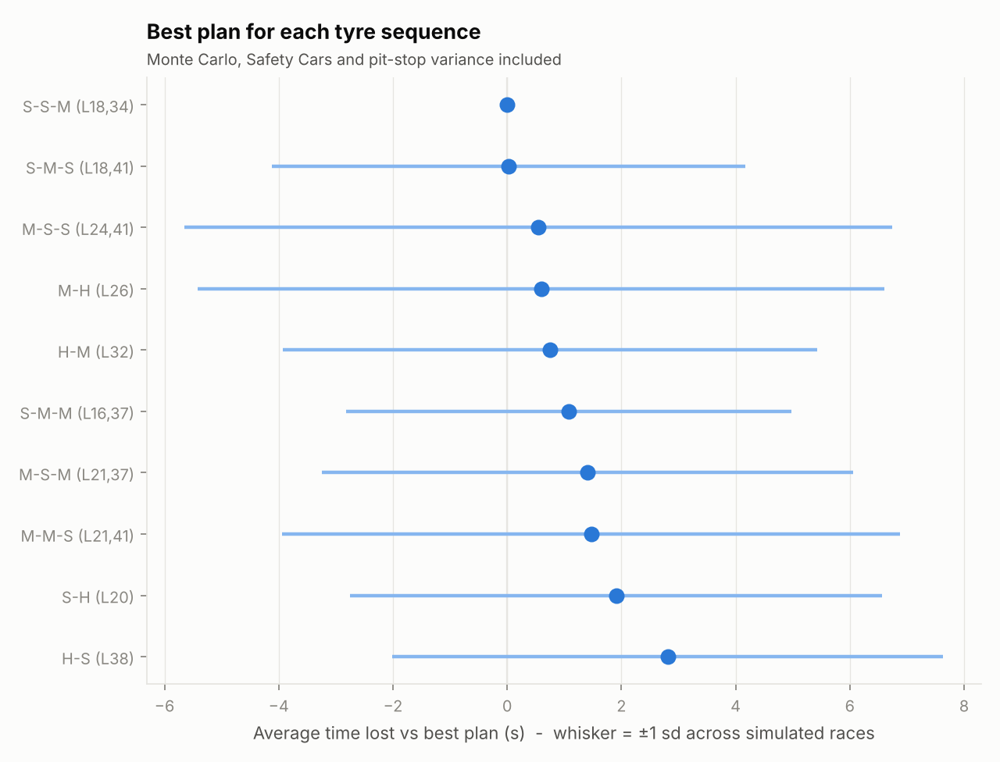
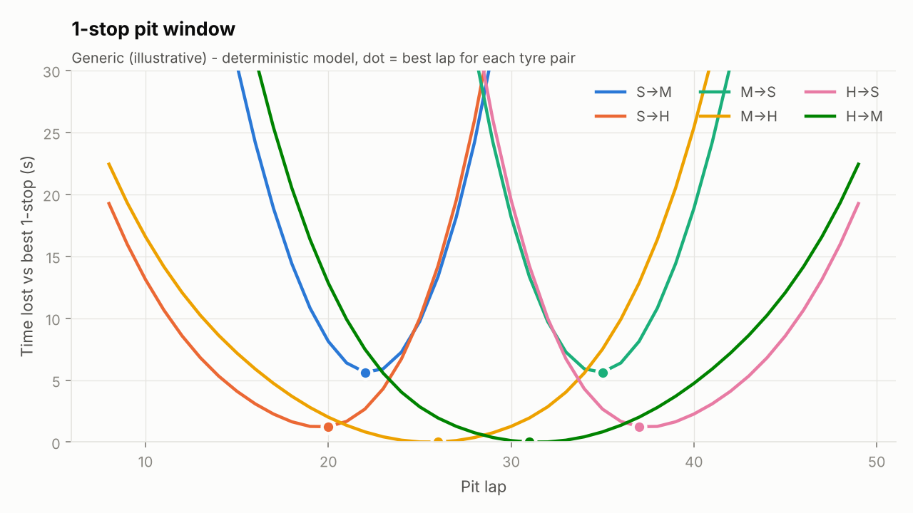
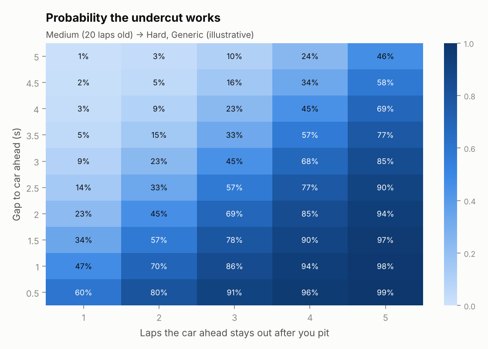

# F1 Race Strategy & Pit-Window Risk Simulator

  !

A Monte Carlo simulator that ranks Formula 1 race strategies (which tyres, when to pit) by **expected race time and risk**. It accounts for tyre degradation, fuel burn, Safety Cars, Virtual Safety Cars, pit-stop variance and botched stops. It fits its inputs from real timing data with [FastF1](https://docs.fastf1.dev).



## What it does

1. **Fits the race** from real FastF1 lap data: tyre degradation per compound (least squares with driver fixed effects), pit-stop time loss, and Safety Car / VSC frequency from past seasons.
2. **Screens every legal strategy** (about 14,500 one- and two-stop plans) with a fast deterministic race model.
3. **Simulates the shortlist** across 5,000+ random races using *common random numbers*: every plan faces the same Safety Cars, slow stops and lap noise, so differences come from the strategy, not luck.
4. **Reacts like a strategist**: if a Safety Car appears within a few laps of a planned stop, the car pits under it, at roughly half the usual time loss.
5. **Evaluates undercuts**: the probability that pitting first gets you past the car ahead, by gap and by how long they stay out.

| 1-stop pit window | Undercut success probability |
|---|---|
|  |  |

*Charts above come from the latest `python scripts/refresh_race.py` run (the repo ships with illustrative example data until you run it).*

## Quick start

```bash
python -m venv .venv
.venv\Scripts\activate            # Windows   (macOS/Linux: source .venv/bin/activate)
pip install -e ".[dev,app]"

pytest                            # 17 tests, all offline
```

**VS Code:** rename the `vscode-setup` folder to `.vscode` to get the test explorer and one-click run configs (Run and Debug panel). Then select the `.venv` interpreter.

```bash

# One command: fit a real race, simulate, undercut grid, refresh the microsite
python scripts/refresh_race.py                 # Bahrain 2024; or: python scripts/refresh_race.py Monza 2024

# Or step by step:
# 1. Fit parameters from a real race (downloads data, then cached in ./cache)
python -m strategy_sim.cli fit --year 2024 --event Bahrain --sc-from 2019 --out params/bahrain_2024.json

# 2. Rank strategies
python -m strategy_sim.cli simulate --params params/bahrain_2024.json --runs 5000

# 3. Undercut grid: mediums 18 laps old -> hards
python -m strategy_sim.cli undercut --params params/bahrain_2024.json --old MEDIUM --new HARD --age 18
```

No `--params`? It falls back to `params/example_generic.json` values, which are illustrative only.

## Interactive dashboards

Two front-ends, branded as **Volta Racing / VR-25**, a fictional team:

| | What it is | How to open |
|---|---|---|
| **HUD dashboard** (`site/index.html`) | Analytics cockpit: glowing 3D wireframe VR-25 with callouts anchored to the car, lap-by-lap race replay, strategy ranking, tyre-degradation model, probability gauges, lap-time projection, strategy timeline, and tabs for live what-if sliders, undercut heatmap and pit-window analysis. Every number is a simulator output, not live telemetry. | Double-click `site/index.html` |
| **Showcase microsite** (`site/showcase.html`) | Scroll-driven 3D showcase (three.js): chase-cam drive, liveries showroom, drag-to-orbit car, tilt cards. | Open from the dashboard's *Showcase* button |
| **Streamlit app** (`app.py`) | Analyst dashboard running the real Python simulator: strategy ranking, pit window, undercut, fitted inputs, CSV download. | `streamlit run app.py` |

After fitting a new race, refresh the microsite data:

```bash
python scripts/export_site_data.py     # simulates every params/*.json -> site/data/results.js
```

The microsite's JavaScript model (`site/model.js`) gives the same deterministic race times as `strategy_sim.model.race_time`, and the Monte Carlo results agree within simulation noise.

## Output columns

| Column | Meaning |
|---|---|
| `gap_to_best_s` | Average race time lost vs the best plan |
| `risk_sd_s` | Spread of that gap across simulated races. High = outcome depends on luck (Safety Car timing) |
| `p_fastest` | Share of simulated races in which this was the fastest plan of all |
| `p_beats_best` | Share of races in which it beats the plan with the best average |
| `deterministic_s` | Race time with no randomness (sanity check) |

## Model

Clean-air lap time for lap *l* on a tyre that is *a* laps old:

```
t = base_lap + offset[c] + deg_lin[c]·a + deg_quad[c]·a² + cliff + fuel_coef·(total_laps − l) + noise
```

- **Fitting:** green-flag laps only, no in/out laps, lap 1 dropped, traffic laps (> 3% off the stint median) removed. Lap times are fuel-corrected, then fitted with one intercept per driver, so car pace doesn't bias the tyre curves.
- **Pit loss:** in-lap + out-lap − 2 × the driver's median clean lap, green-flag stops only, slowest 10% trimmed (botched stops are modelled separately as `slow_stop_prob`).
- **Safety Cars:** P(≥1 SC in the race) from past seasons at the circuit (Laplace-smoothed), turned into a per-lap Poisson hazard. Lasts 3–5 laps (VSC 2–3).
- **Search:** deterministic screen keeps the top 40 plans plus the best 2 of every tyre sequence, then Monte Carlo on that shortlist.

## Assumptions and limitations

- `fuel_coef` (0.055 s per lap of fuel) is an assumption, not fitted. Change it with `--fuel-coef`.
- Single car in clean air. **No traffic or overtaking yet**, and no gap compression behind a Safety Car.
- Dry races only. No red flags, weather changes or tyre-allocation limits.
- The degradation fit has no cliff term; long stints on soft tyres may look better than they are.
- `fit` was tested on synthetic FastF1-shaped data. Validate against a real race before trusting the numbers.

## Roadmap

- [ ] Full 20-car field with traffic, dirty air and an overtaking probability model
- [ ] Back-test: compare predicted best strategies with what the top 5 actually ran in 5 past races
- [ ] Back-test the undercut model against real undercut attempts
- [ ] Read inputs from the Project 1 PostgreSQL database
- [ ] Streamlit "Strategy Lab" page (Project 3)

## Project layout

```
app.py            Streamlit dashboard
site/             dashboard (index.html, dash.css, dash.js), showcase (showcase.html, styles.css, main.js),
                  shared: model.js (JS simulator), three-scene.js (3D), data/, fonts/, vendor/
scripts/          export_site_data.py
src/strategy_sim/
  params.py       RaceParams / CompoundModel, JSON load & save
  strategies.py   Strategy + enumeration of legal plans
  model.py        deterministic race model
  montecarlo.py   scenarios (SC/VSC/noise), simulation, screening, ranking
  undercut.py     undercut probability
  estimate.py     fit parameters from FastF1
  plots.py        charts
  cli.py          command line
tests/            pytest suite (offline, synthetic data)
params/           parameter files
results/          CSVs and charts
```

## License

Code: MIT (see `LICENSE`). Bundled fonts: SIL Open Font License (`site/fonts/`). three.js: MIT (`site/vendor/`).

## Data

Timing data comes from FastF1, which also uses the Jolpica-F1 API. Historical sessions are free and need no account. This is an unofficial project, not affiliated with Formula 1.
